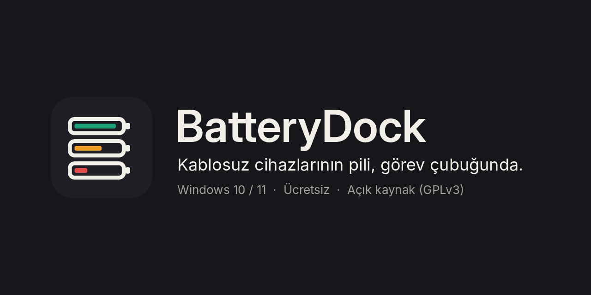
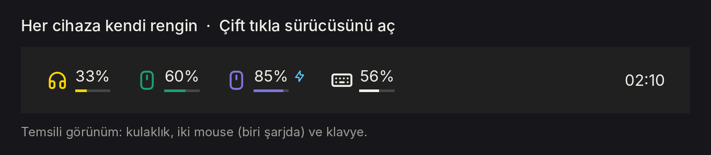
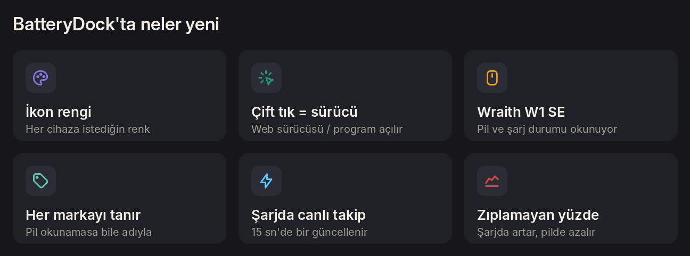

# BatteryDock

Kablosuz mouse, klavye, kulaklık ve oyun kollarının pil seviyesini Windows görev çubuğunda gösteren hafif bir uygulama.
*A lightweight Windows taskbar app that shows the battery level of wireless mice, keyboards, headsets and controllers.*

BatteryDock, [krisgfx9](https://github.com/krisgfx9) tarafından geliştirilen açık kaynak
**[BatteryHub (Wireless-Device-Battery-Monitor)](https://github.com/krisgfx9/Wireless-Device-Battery-Monitor)**
projesinin bir çatalıdır (fork). Cihaz desteğinin büyük kısmı ve temel uygulama o projeye aittir; emeği için teşekkürler.
Orijinal proje belgesi: [docs/UPSTREAM_README.md](docs/UPSTREAM_README.md).



## BatteryDock'ta eklenenler



- **İkon rengi:** Her cihaza istediğin rengi ver (sağ tık → cihaz → *İkon rengi...*). Renk ikona ve pil çubuğuna uygulanır; pil düşükken uyarı kırmızısı korunur.
- **Çift tıkla sürücüyü aç:** Görev çubuğunda bir cihaza çift tıklayınca o cihazın yazılımı / web sürücüsü açılır.
  Hazır bağlantılar: Wraith (w1.software), Logitech G HUB, Razer Synapse, Corsair iCUE, SteelSeries GG, ASUS Armoury Crate.
  Diğer cihazlar için bağlantıyı bir kez sen girersin (*Sürücü bağlantısı...*).
- **Wraith W1 SE desteği:** `0738:A0AF` alıcısı ve `0738:A09F` kablo, Wraith web sürücüsündeki salt-okunur durum sorgusuyla.
- **Her markayı tanıma:** Pili okunamayan cihazlar da üretici kimliğinden markası bulunarak listelenir (90+ marka). Kablolu görünenler varsayılan olarak gizlidir.
- **Şarjda canlı takip:** Bir cihaz şarj olurken pil 15 saniyede bir okunur. Kontrol aralığına 10 sn ve 15 sn seçenekleri eklendi.
- **Zıplamayan yüzde:** Şarjda yüzde yalnızca artar, pildeyken yalnızca azalır (60 → 62 → 61 oynamaları gizlenir).
- **Ayar taşıma:** İlk açılışta BatteryHub ayarları (isimler, sıralama, uyarılar) otomatik alınır.

## Kurulum

[Releases](../../releases) sayfasından:

- **BatteryDock-Setup-x.y.z.exe** — normal kurulum (Başlat menüsü, kaldırma, isteğe bağlı Windows ile başlat; yönetici izni gerekmez).
- **BatteryDock-x.y.z-portable.zip** — kurulumsuz; çıkar ve `BatteryDock.exe`'yi çalıştır. Açılışta başlaması için: sağ tık → *Windows ile başlat*.

İmzasız olduğu için Windows SmartScreen uyarı verebilir: *Ek bilgi* → *Yine de çalıştır*.

## Derleme

MSYS2 (MINGW64/UCRT64) içinde:

```
make VERSION=1.0.0
```

veya `build.bat`. Kurulum dosyası: `makensis -DVERSION=1.0.0 installer/BatteryDock.nsi` (çıktı `dist/` klasörüne). Ayrıntılar: [docs/UPSTREAM_README.md](docs/UPSTREAM_README.md).

## Lisans

GNU General Public License v3.0 — bkz. [LICENSE](LICENSE). BatteryDock, BatteryHub'ın (© krisgfx9 ve katkıda bulunanlar) değiştirilmiş bir sürümüdür;
değişiklikler bu depodaki commit geçmişinde görülebilir. Üçüncü taraf bildirimleri: [installer/THIRD_PARTY_NOTICES.txt](installer/THIRD_PARTY_NOTICES.txt).
