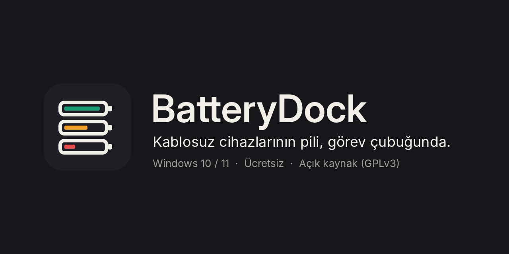
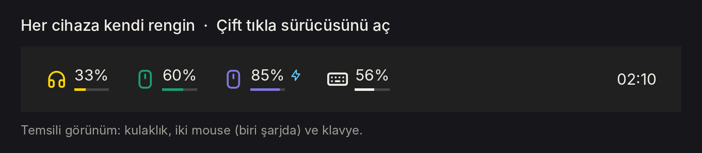
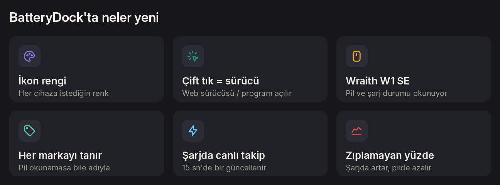

# BatteryDock 1.0.0

Kablosuz mouse, klavye, kulaklık ve oyun kollarının pil seviyesini **Windows görev çubuğunda** gösteren hafif bir uygulama.
Üretici yazılımlarına (G HUB, Synapse, iCUE, GG…) gerek kalmadan, cihazlarla doğrudan konuşur.

## İndir

| Dosya | Ne için |
|---|---|
| **BatteryDock-Setup-1.0.0.exe** | Önerilen. Kurar, Başlat menüsüne ekler, *Ayarlar → Uygulamalar*'dan kaldırılabilir. Yönetici izni istemez. |
| **BatteryDock-1.0.0-portable.zip** | Kurulumsuz. Zip'i çıkar, `BatteryDock.exe`'yi çalıştır. |

> İmzasız olduğu için Windows SmartScreen uyarı verebilir: **Ek bilgi → Yine de çalıştır**.

## Neler yeni

- **İkon rengi** — Sağ tık → cihaz → *İkon rengi...* ile her cihaza istediğin rengi ver. Renk ikona ve pil çubuğuna uygulanır; pil düşükken uyarı kırmızısı korunur.
- **Çift tıkla sürücüyü aç** — Görev çubuğunda bir cihaza çift tıkla, o cihazın yazılımı ya da web sürücüsü açılsın. Hazır bağlantılar: Wraith (w1.software), Logitech G HUB, Razer Synapse, Corsair iCUE, SteelSeries GG, ASUS Armoury Crate. Diğerleri için bağlantıyı bir kez sen girersin (*Sürücü bağlantısı...*).
- **Wraith W1 SE desteği** — Alıcı (`0738:A0AF`) ve kablo (`0738:A09F`) bağlantısında pil yüzdesi ve şarj durumu.
- **Her markayı tanır** — Pili okunamayan cihazlar da üretici kimliğinden markasıyla listelenir (90+ marka). Kablolu görünenler varsayılan olarak gizli; menüden açılabilir.
- **Şarjda canlı takip** — Bir cihaz şarj olurken pil 15 saniyede bir okunur. Kontrol aralığına 10 sn ve 15 sn seçenekleri eklendi.
- **Zıplamayan yüzde** — Şarjdayken yüzde yalnızca artar, pildeyken yalnızca azalır; 60 → 62 → 61 gibi oynamalar görünmez.
- **Yeni ad ve simge** — BatteryDock adı ve "pil rafı" simgesi. Orijinal BatteryHub ile yan yana kurulabilir; ilk açılışta BatteryHub ayarları (isimler, sıralama, uyarılar) otomatik alınır.

## Teşekkür ve lisans

BatteryDock, [krisgfx9](https://github.com/krisgfx9)'in açık kaynak **[BatteryHub](https://github.com/krisgfx9/Wireless-Device-Battery-Monitor)** projesinin bir çatalıdır; cihaz desteğinin büyük kısmı o projeye aittir.
Lisans: **GNU GPL v3.0**. Kaynak kodu bu depodadır.

---

### English

**BatteryDock** shows the battery level of wireless mice, keyboards, headsets and controllers on the Windows taskbar. It is a fork of [BatteryHub](https://github.com/krisgfx9/Wireless-Device-Battery-Monitor) (GPLv3) and adds per-device icon colors, double-click to open a device's driver/web configurator, Wraith W1 SE support, brand recognition for every device, faster polling while charging, steadier percentages, and a new name and icon.
Download the **Setup** for a normal install or the **portable zip** to run without installing.
